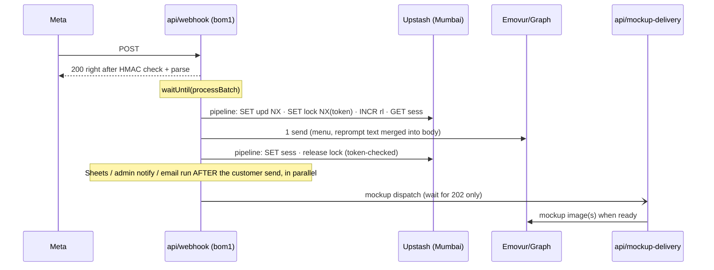

# Plan: Sub-second static replies and a more reliable webhook

Status: in progress. Tick each box when its task is merged and `npm test` + `npm run typecheck` pass.

## Task list

- [x] **T1** Latency tracing and test harness (timing logs, injectable transport, fakeRedis pipeline, `/api/health` host field)
- [x] **T2** Redis hot path: cross-instance dedupe, lock, rate limit and draft load in 1 pipeline; save + unlock in 1 pipeline
- [x] **T3** Fast 200 with `waitUntil`; per-chat batching; skip statuses-only payloads
- [x] **T4** One send per static screen; 8s send timeout + 1 retry; safer menu fallback
- [x] **T5** Lazy-load heavy modules (sharp, Sheets, Blob, AI, qrcode, Sentry); cold-start test
- [ ] **T6** Faster quote/payment; customer reply first, Sheets + admin notify in parallel after
- [ ] **T7** AI mockup only in the worker; quote/QR sent at once; 3 free per month then ₹20 paid flow
- [ ] **T8** Every failure gets a customer reply; timeouts on Sheets
- [ ] **T9** `regions: ["bom1"]`, warm endpoint for uptime pinger, latency probe script, docs + `BUILD_STAMP`

## Goal

Static (button, menu, text) replies reach the customer in under 1 second. Only the AI mockup step may take longer, and it never blocks the flow.

## Requirements

- **Speed:** on a warm instance, a static reply costs at most 1 Redis round-trip before the send, 1 WhatsApp send, and 1 Redis round-trip after. Server-side p95 under 500ms. Cold starts as short as possible.
- **Mockup:** on "Generate", the quote and QR arrive immediately; the mockup arrives later from the worker.
- **Quota (confirmed):** 3 free mockups per Asia/Kolkata month, then ₹20 with admin approval. All generation goes through `startMockupGeneration`.
- **Reliability:** across instances, each message is processed once and one chat is handled at a time. Drafts are never stale or lost. Every failure gets a customer reply. Every payment event reaches the admins (AGENTS.md invariant 3).
- **Uptime pinger:** included (confirmed).
- **Constraints:** Vercel Hobby, region `bom1`, Upstash in Mumbai, sends go through Emovur (`META_API_BASE_URL=https://metagraph.backendprod.com`). Pricing, status machines and click-first flow unchanged. Copy changes limited to concatenating existing strings plus one new line `COPY.mockupArrivingShortly`. Never print secret values from `.env*`.

## Audit findings

| Area | Finding | Where |
|---|---|---|
| Webhook | Sends 200 only after processing; no `waitUntil`; messages handled one after another; dedupe marker claimed before processing and never released on failure | `api/webhook.ts` ~193–229 |
| In-memory guards | Dedupe, chat lock and rate limit are in-memory Set/Map, so they don't work across instances | `src/session/dedupe.ts`, `chatLock.ts`, `rateLimit.ts` |
| Drafts | Memory cache read first and never refreshed (stale); non-persist `saveDraft` fires an un-awaited Redis SET that can be lost on freeze | `src/session/draftStore.ts` 30–56 |
| Cold start | sharp, google-spreadsheet + google-auth-library, @vercel/blob, qrcode (dead `if (false)`), @sentry/node, @upstash/ratelimit and AI clients imported at top level | `src/bot/index.ts`, `src/conversation/orderFlow.ts` |
| Extra sends | Reprompt, resume, back-at-start and catalog each make 2 sends; mockup prompt waits on `peekUsage`; `mockup:skip` costs ~5 sequential Redis calls + 3 sends; snapshot saved twice | `orderFlow.ts` ~712–1050 |
| Send client | 35s timeout cleared before body read; no retries; `sendMenu` falls back to a text menu on any error (possible double send) | `src/whatsapp/metaClient.ts`, `src/conversation/uiMapper.ts` |
| completeOrder | ack → orderId → snapshot → Sheets (3 retries with sleeps) → notifyAdmins (media + Blob + email + per-admin sends) → DEL, all sequential; first send unguarded | `orderFlow.ts` ~1085 |
| Mockup | `triggerMockupDelivery` runs full delivery, incl. AI (90s timeout), inside the 60s webhook and skips the quota; worker job has no outer catch; OpenAI result download and Blob `put` have no timeout | `src/mockup/deliverTrigger.ts` 44–59, `deliver.ts` 85–113, `api/mockup-delivery.ts` |
| Tests | `mockupTiming.test.ts` only searches source text; requires literals `triggerMockupDelivery(order.orderId)` and `generateUpiQrPng(env.MERCHANT_VPA` | `tests/mockupTiming.test.ts` |
| Config | No `regions` key; webhook maxDuration 60, mockup-delivery 120 (needs Fluid compute on Hobby) | `vercel.json` |

Test seams available: `__setRedisForTests` (`redisClient.ts`), `tests/support/fakeRedis.ts`, `fakeSheetStore.ts`, `fakeOrdersSheet.ts`, `testEnv.ts`, `MockupDeliveryDeps` in `deliver.ts`. Upstash REST `pipeline()`/`multi()` send N commands in one HTTP request; `eval` works inside a pipeline.

## Target design

Design rules:
1. **Fast 200:** verify signature, parse JSON, return 200, process inside `waitUntil` (`@vercel/functions`). Chats in parallel; messages within a chat in order.
2. **One Redis round-trip at start, one at end.** Redis is the source of truth for drafts; memory cache removed. On failure, delete the dedupe marker so Meta's retry is processed.
3. **One send per static screen.** Sends: 8s timeout covering body read, 1 retry for network errors and 429 only.
4. **Heavy modules via `await import()`** only on paths that need them.
5. **Customer first, side work after**, with `Promise.allSettled`. Escalation behaviour unchanged.
6. **Mockups only in the worker** via `startMockupGeneration`, with hard timeouts on every external call.

## Tasks

### T1: Latency tracing and test harness
- Add `src/shared/timing.ts`: one structured log line per message `{msgId(masked), step, redisMs, sendMs, totalMs, cold}`.
- Make the WhatsApp transport in `src/whatsapp/metaClient.ts` injectable via `__setTransportForTests(fn)`.
- Extend `tests/support/fakeRedis.ts`: `pipeline()`/`multi()` with `exec()`, `eval` for the lock-release script, round-trip counters.
- `/api/health`: add `metaApiHost` = `"graph"` | `"emovur"` | `"other"` (host type only, no secrets).
- Test `tests/latencyBudget.test.ts`: tier button press through `handleMessage` with fakes; record Redis round-trips and sends (baseline).

### T2: Redis hot path
- New `src/session/hotPath.ts`:
  - `begin(chatId, msgId)` → one pipeline: `SET upd:<msgId> 1 NX EX 86400`, `SET lock:<chatId> <token> NX EX 30`, `INCR rl:<chatId>:<epochMinute>` + `EXPIRE 120`, `GET sess:<chatId>`. Returns `{isNew, locked, token, allowed, draft}`. Limit 20 msgs/min.
  - `finish(chatId, token, draft | null | undefined)` → one pipeline: `SET sess:<chatId> EX 86400` (or DEL when `null`) + Lua token-checked lock release.
  - `abort(msgId)` → `DEL upd:<msgId>`.
- Lock held → retry `SET NX` up to 3× at 150ms, then `COPY.busyReprompt`.
- `draftStore`: remove memory-first read and fire-and-forget SET; `loadDraft` returns the draft fetched by `begin` via a per-request context; `saveDraft`/`clearDraft` record changes that `finish()` writes. Keep function names. `persistToRedis=true` still writes immediately.
- Replace in-memory `dedupe.ts`/`chatLock.ts`/`rateLimit.ts` with wrappers over hotPath (or remove and update importers). Wire into `src/bot/index.ts`.
- Tests: duplicate id processed once; concurrent same-chat messages serialized; lock TTL; only token holder releases; failure clears dedupe marker; draft fresh across instances; budget test asserts exactly 2 Redis round-trips per static step.

### T3: Fast 200 with `waitUntil`
- `api/webhook.ts`: after HMAC + parse, collect messages from both payload shapes; statuses-only → 200 with 0 Redis calls; else `res.status(200).send("EVENT_RECEIVED")` then `waitUntil(processBatch(messages))`.
- Group by chat; chats via `Promise.allSettled`; within a chat in order. Remove the "Acknowledge 200 AFTER" logic. GET handshake and 401 on bad signature unchanged. `waitUntil` injectable for tests.
- Tests: responds before a slow stubbed `handleMessage` resolves; two chats concurrent; one chat ordered; statuses-only 0 Redis calls; bad signature 401.

### T4: One send per static screen
- `promptNext(chatId, draft, isReprompt, prefix?)` prepends `COPY.genericReprompt` / prefix to the menu body. Use prefix for "▶️ Order resumed! Let's continue:", "You're already at the beginning…" and `COPY.catalogsListMessage` (keep separate if body would exceed 1024 chars). Wording unchanged.
- `metaClient.ts`: 8s timeout covering body read; 1 retry with 300ms backoff on network errors and 429 only; one log line per send with `sendMs`.
- `uiMapper.sendMenu`: text fallback only on 4xx validation errors, not on timeout/abort.
- Tests: reprompt/resume/back = 1 send; catalog expected count; transport error retried once; 400 → fallback; timeout → no fallback.

### T5: Lazy-load heavy modules
- `await import()` for `safeAppendOrderRow`, `notifyAdmins`, `triggerMockupDelivery`, `peekUsage` in `orderFlow.ts`; `handleAdminAction`, `handleMockupGenAction`, `handleAdminTextCommand`, `getChatPendingGenerationId`, `attachPaymentProof` in `bot/index.ts`. Move `isAuthorizedAdmin` to a light module so it stays static.
- Lazy `@vercel/blob` in `storage/blob.ts` `defaultUploader`; lazy Sentry in `initSentry`/`captureException`.
- Remove the dead `generateUpiQrPng` import and `if (false)` block (T7 updates `mockupTiming.test.ts`).
- Test `tests/coldStart.test.ts`: child Node process (`--import tsx`) imports `api/webhook.ts`; assert `sharp`, `google-spreadsheet`, `google-auth-library`, `@vercel/blob`, `qrcode`, `@sentry/node` not loaded; log import time. Record before/after numbers in the Results section below.

### T6: Faster quote and payment
- `nextOrderId`: INCR + EXPIRE in one pipeline.
- Write the order snapshot once (remove the duplicate between mockupDecision and payment).
- Payment: 3 sends in order (quote, QR, pay message), nothing awaited in front of them.
- `completeOrder`: guarded `COPY.screenshotAck` first → snapshot → `Promise.allSettled([safeAppendOrderRow, notifyAdmins])`. `admin/notify.ts` sends to all admins in parallel. Sheet-failure escalation and customer apology unchanged.
- Tests: ≤2 Redis round-trips before first payment send; ack is first transport call; failing Sheets still escalates + apologises; failing ack still writes Sheets + notifies admins.

### T7: Asynchronous AI mockup via worker, 3 free per month
- `deliverTrigger.ts`: delete in-process `deliverMockupForOrder`; always dispatch to `/api/mockup-delivery`, waiting for the 202 (3s timeout). Keep snapshot write; keep the loud error when `INTERNAL_MOCKUP_SECRET` is unset.
- `orderFlow.ts` "generate": one message = existing generating text + new `COPY.mockupArrivingShortly`; dispatch; go straight to quote/QR/pay.
- `api/mockup-delivery.ts`: outer try/catch inside the `waitUntil` job escalating via `notifyAdminsText`; keep `startMockupGeneration` (quota + ₹20 flow, `COPY.mockupPaidRequired`).
- `openaiClient.ts`/`geminiClient.ts`: timeout covers `response.json()`; 30s timeout on OpenAI result-URL download. `deliver.ts`: parallel logo fetch; 20s timeout around Blob `put`.
- Pending paid-mockup proof (`mockupgen:pending:<chatId>`) keeps priority over the payment-screenshot step.
- Tests: replace source-text `mockupTiming.test.ts` with a behavioural test (webhook "generate" never calls the compositor, exactly one dispatch); 4th Kolkata-month generation → `awaiting_payment`; worker AI timeout → `failed` record, reservation released, admin alert; existing quota/workflow tests pass.

### T8: Every failure gets a reply
- `handleMessage` top-level catch: guarded generic apology, `abort(msgId)`, lazy `captureException`; `finally` always runs `finish()`.
- Move `loadDraft`, cancel, back, start and catalog branches in `handleWhatsAppMessage` inside the guarded block.
- `src/shared/withTimeout.ts`; wrap Sheets calls (10s).
- Tests: error injected in draft load, cancel, admin handler and processStep → exactly one apology send and lock released.

### T9: Deploy config, pinger, measurement, docs
- `vercel.json`: `"regions": ["bom1"]`. Fluid compute must be ON in the Vercel dashboard (Hobby needs it for maxDuration 120).
- `GET /api/webhook?warm=1` → 204 with no Redis/Meta calls. README: point UptimeRobot / cron-job.org at it every 5 min.
- `scripts/latency-probe.ts` + npm script `latency-probe`: times N lightweight Graph calls via `META_API_BASE_URL` and optionally `graph.facebook.com`; prints p50/p95; never prints tokens.
- Update `AGENTS.md` and wrong `.kiro/steering` notes: WhatsApp channel, keys `upd:`/`lock:`/`rl:`/`sess:`, fast 200 with `waitUntil`, worker-only mockup. Bump `BUILD_STAMP` in `src/config/version.ts`.
- Full `npm test` + `npm run typecheck` pass.

## Manual steps for you (after deploy)

1. Vercel dashboard → Settings → Functions: confirm Fluid compute is ON and region is Mumbai (`bom1`).
2. Create a free UptimeRobot / cron-job.org monitor hitting `https://<your-domain>/api/webhook?warm=1` every 5 minutes.
3. Run `npm run latency-probe` and decide whether to keep Emovur.

## Results

| Metric | Before | After |
|---|---|---|
| Webhook module import time (local, tsx, `tests/support/coldStartProbe.ts`) | ~10.6s (10722 / 10569ms) | ~0.4–1.4s (398–1449ms) |
| Redis round-trips per static step | | |
| Sends per reprompt | 2 | 1 |
| Warm static reply, server p95 | | |
| Cold static reply | | |
| Quote screen | | |
| Screenshot ack | | |

## Not in this plan (later)

- Cache each order's sheet row number in Redis so admin status updates stop scanning every row.
- Dynamic UPI QR with the amount filled in (static Razorpay QR kept as a client decision).
